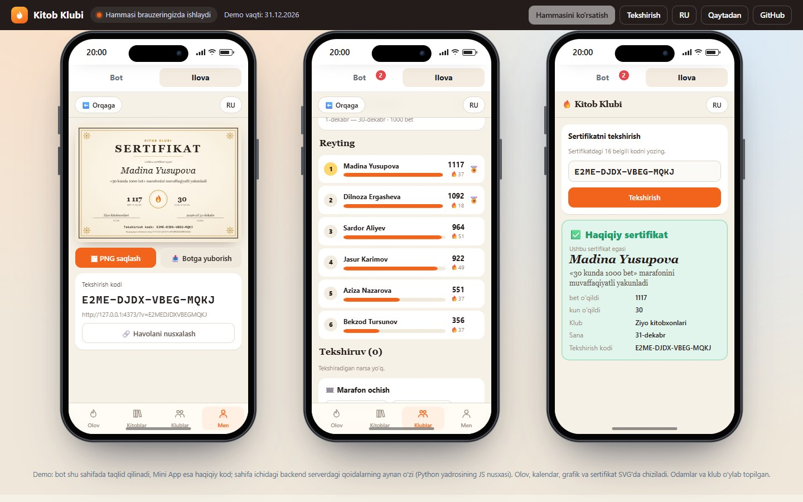
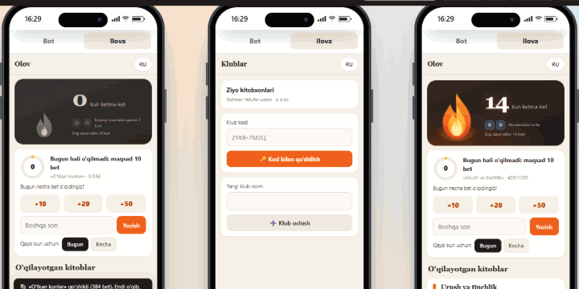
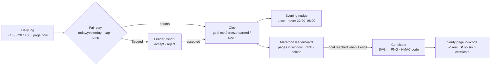

# Kitob Klubi

**English** · [O'zbekcha](README.uz.md)

[](https://github.com/xoliddev/kitob-klubi/actions/workflows/ci.yml)
[](https://xoliddev.github.io/kitob-klubi/)
[](LICENSE)


A **reading club for Uzbekistan**: a Telegram bot (everything works from buttons) plus a Mini App. A reader adds a
book — "O'tkan kunlar", "Kecha va kunduz", "Shum bola", "Sariq devni minib", world classics in Uzbek, or any book typed
by hand — and logs pages with one tap: *"Bugun necha bet o'qidingiz?"* **+10 / +20 / +50**, another number, or
*"hozir qaysi betdasiz?"*. The bot answers with the progress and a pace forecast: *"Shu tezlikda «O'tkan kunlar»ni
taxminan 12-dekabrda tugatasiz"*. A teacher or librarian leads a club and runs marathons ("30 kunda 1000 bet").

**The wow moment — the daily olov 🔥 and a real certificate.** Every Tashkent day the reader meets *their own* goal
(10 pages unless they change it), the flame grows. Every 7 such days earn a **muzlatish** (freeze, at most 2); a missed
day quietly spends one and the flame survives — *"Kecha o'qilmadi — 1 ta muzlatish ishlatildi, olov saqlab qolindi"*.
An evening nudge comes only if today's goal is not met (*"Olovingiz o'chmasin: bugun yana 6 bet"*), at most once a day,
never between 22:00 and 08:00. Finish a marathon and you get a **certificate drawn in SVG** — name, achievement,
pages, days, club, date and a 16-letter code signed with HMAC. Save it as PNG, send it to the bot, share it: anyone
can open `…/webapp/?v=<code>` in any browser and see **"✅ Haqiqiy sertifikat"**, or **"❌ Bunday sertifikat yo'q"**
for an edited or invented code.

**[Live demo →](https://xoliddev.github.io/kitob-klubi/)** three phones side by side (Madina the reader, Nilufar ustoz
the club leader, Sardor another reader), a simulated bot and the real Mini App code. Everything runs in your browser.



<p align="center"></p>

## Features

- **Books.** A catalog of well-known Uzbek and world classics in Uzbek (titles, authors and typical page counts only —
  no book text) or any book typed by hand, with the pages already read. Up to five at a time.
- **One-tap logging.** +10 / +20 / +50, another number, or the page you are on now; for today or yesterday (until
  midnight — a forgotten evening can still be saved). Progress bar, the pace over the last two weeks and the day you
  will likely finish; finishing asks for a 1–3 sentence **fikr**.
- **The olov.** Streak, best streak, freezes (7 counted days earn one, at most 2, a miss spends one), a flame that grows
  with the streak, a 15-week calendar heatmap (freeze days in ice blue), pages per week, favourite authors.
- **Clubs and marathons.** A leader opens a club; readers join by its code or the `start=k_<code>` deep link. A
  marathon has a title, start, length (3–120 days) and goal. Members see the **live leaderboard** (pages in the
  marathon window, streak, books); the leader also sees who is falling behind (less than 70 % of the calendar's pace
  from day 3). Members can leave; the leader can remove a member or change the code.
- **Fair play.** Logs only for today or yesterday; a **daily cap** (300 pages unless `DAILY_CAP` says otherwise) trims
  a bigger claim; a trimmed claim or a sudden jump (above 150 pages *and* three times the reader's usual day) is
  **flagged** for the leader, who can ask for an **isbot** — 1–2 sentences about what was read — and accept or reject.
  Rejected pages stop counting everywhere: the book, the streak, the marathon.
- **Certificates.** Issued once per achievement (a marathon goal reached, or a finished book when the leader enables
  it). Drawn in SVG, saved as PNG in the browser, sent to the bot as a file. The check page works outside Telegram.
- **Buttons only.** `/start` (with its deep links) is the only command; every screen has "⬅️ Orqaga". Uzbek by
  default, Russian with one tap — in the bot and in the Mini App.

All people and clubs are **fictional**; seeded people have negative ids (Telegram user ids are always positive), so
nobody can sign in as them. Seeds are relative to "today" and tested over 30 days, across New Year and across the
Tashkent midnight.

## How it works



The rules live in a pure core (`kitobklubi/core/`, whole numbers only) with a line-by-line JavaScript port
(`shared/*.js`) for the Mini App and the demo. `scripts/make_vectors.py` writes `shared/test_vectors.json` from the
Python core — streaks with freezes across New Year, the pace forecast, the cap and the jump, the leaderboard ranks,
certificate codes and their forgeries, the heatmap, the seeded world and even the sentence *"Shu tezlikda … tugatasiz"*
in both languages — and `node --test` checks the JS port against it, so a number shown in the bot, the Mini App, the
leaderboard and the certificate is always the same number.

| Part | Where |
|---|---|
| Pure core: calendar, books and pace, streak and freezes, fair play, marathons, certificate codes, stats, nudge, seed | `kitobklubi/core/`, `shared/*.js` |
| Service: reading, clubs, fair play, certificates, the tick (SQLite, WAL, `BEGIN IMMEDIATE`) | `kitobklubi/*.py` |
| Bot (aiogram 3, buttons only) | `kitobklubi/bot/` |
| Mini App + its API (aiohttp) + the public check page | `webapp/`, `kitobklubi/web*.py` |
| Browser demo (in-page backend, simulated bot, guided story) | `demo/` |

## Security

- **Mini App auth:** every API call carries Telegram `initData`; its HMAC is checked in constant time and `auth_date`
  must be fresh (default 1 hour, a little clock skew allowed). The user id always comes from it.
- **Who may do what:** readers change only their own books and logs (anyone else's id answers "not_found"); leaders
  see codes, flags and who is behind only in clubs they lead, and judge only logs of their own members; callback data
  is matched by strict regexes and re-checked against the caller.
- **Certificates:** 5 random bytes + the first 5 bytes of HMAC-SHA256 with a server secret, in a 32-letter alphabet;
  the signature is checked in constant time before the database is asked; malformed, forged, edited and unknown codes
  all get the same answer; the public check is rate-limited per address and returns no ids. Club codes are 40 random
  bits; wrong codes are rate-limited per person.
- **Input:** strict validation (pages 1–5000 per claim, the daily cap, page numbers inside the book, today or
  yesterday only, lengths and sentence counts for reviews and proofs, marathon days and goals, nudge times on the half
  hour), parameterised SQL, rules also in the schema (`CHECK`, `UNIQUE`), a 16 KB body cap (1 MB for a PNG, which must
  be a real PNG up to 4000 px), per-user rate limits.
- **Output:** user text (names, titles, reviews, proofs) is escaped in bot messages and only ever set as
  `textContent` in the Mini App and the SVG; a strict CSP.
- **Ops:** non-root, read-only container; no secrets in the repo (`.env` is ignored, `.env.example` has placeholders).

## Run it

```bash
cp .env.example .env          # put your BOT_TOKEN from @BotFather in .env
pip install -r requirements.txt
python -m kitobklubi
```

The Mini App needs a public HTTPS address (`PUBLIC_URL`, for example a free cloudflared tunnel); without it the bot
works on its own and certificates are checked in the bot (`start=v_<code>`). With Docker:

```bash
docker compose up -d --build
```

Development:

```bash
pip install -r requirements-dev.txt
ruff check . && pytest                       # core, service, bot (mocked Telegram), HTTP
node --test js-tests/*.test.mjs              # JS port parity + the demo story headless
npm i --no-save playwright && node scripts/e2e.mjs   # the demo in Chromium at 1440 and 375 px
python scripts/make_vectors.py               # after changing the Python core
```

## Tests

- **pytest (22):** the core and its vectors; the whole story on the service (the first page, a week of reading, the
  freeze, the marathon, the capped 900 pages, the isbot, the finished book, the certificate and its check); who may
  do what; rejected pages taken back everywhere; yesterday and the cap; nudges once and never at night; book
  certificates; the olov over 30 days across Tashkent midnight and New Year; the real aiogram handlers against a mocked
  Bot API; HTTP (auth, isolation, the uniform public check, the PNG, limits, CSP).
- **node --test (12):** the JS port against the Python vectors; the demo story on 30 consecutive days, across New Year,
  at night, in the morning and late evening, in order and out of order; the bot and the API stand-ins.
- **Playwright (45 checks):** the demo at 1440 px and 375 px with zero console errors, the PNG download, the picture
  sent to the bot, a `?v=` link and the Mini App outside Telegram.

## Docs

- [CHANGELOG.md](CHANGELOG.md)
- Media: [thumbnail](docs/media/thumb.jpg), [desktop](docs/media/demo-desktop.jpg), [phone](docs/media/demo-mobile.jpg)

MIT © xoliddev
