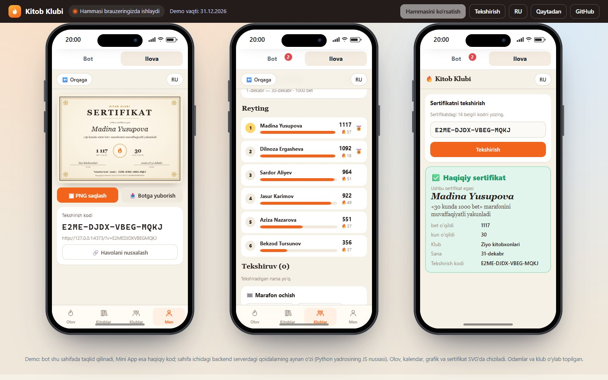

# Kitob Klubi

[English](README.md) · **O'zbekcha**

[](https://github.com/xoliddev/kitob-klubi/actions/workflows/ci.yml)
[](https://xoliddev.github.io/kitob-klubi/)
[](LICENSE)

**Kitobxonlar klubi**: Telegram bot (hammasi tugmalar bilan ishlaydi) va Mini App. O'quvchi kitob qo'shadi —
"O'tkan kunlar", "Kecha va kunduz", "Shum bola", "Sariq devni minib", o'zbek tilidagi jahon klassikasi yoki o'zi yozgan
istalgan kitob — va betlarni bitta bosish bilan yozadi: *"Bugun necha bet o'qidingiz?"* **+10 / +20 / +50**, boshqa son
yoki *"hozir qaysi betdasiz?"*. Bot tezlikni hisoblab aytadi: *"Shu tezlikda «O'tkan kunlar»ni taxminan 12-dekabrda
tugatasiz"*. O'qituvchi yoki kutubxonachi klub ochadi va marafon o'tkazadi ("30 kunda 1000 bet").

**Asosiy narsa — har kungi olov 🔥 va haqiqiy sertifikat.** O'quvchi har kuni *o'z* maqsadiga yetsa (odatda 10 bet),
olov kattalashadi. Ketma-ket 7 kun uchun bitta **muzlatish** beriladi (ko'pi bilan 2 ta). O'qilmagan kun muzlatishni
ishlatadi va olov o'chmaydi: *"Kecha o'qilmadi — 1 ta muzlatish ishlatildi, olov saqlab qolindi"*. Kechqurun, agar
bugungi maqsad bajarilmagan bo'lsa, bitta eslatma keladi (*"Olovingiz o'chmasin: bugun yana 6 bet"*); 22:00 dan 08:00
gacha hech narsa yuborilmaydi. Marafonni yakunlagan kishi **sertifikat** oladi: ism, yutuq, betlar, kunlar, klub, sana
va 16 belgili kod. Uni PNG qilib saqlash, botga yuborish va ulashish mumkin. Istalgan odam `…/webapp/?v=<kod>`
sahifasini ochib **"✅ Haqiqiy sertifikat"** yoki o'zgartirilgan kod uchun **"❌ Bunday sertifikat yo'q"** degan javobni
ko'radi.

**[Jonli demo →](https://xoliddev.github.io/kitob-klubi/)** uchta telefon yonma-yon: o'quvchi Madina, klub rahbari
Nilufar ustoz va Sardor. Hammasi brauzeringizda ishlaydi.



## Nimalar bor

- **Kitoblar:** mashhur kitoblar ro'yxati (faqat nomi, muallifi va betlar soni — kitob matni yo'q) yoki o'zingiz
  yozgan kitob. Bir vaqtda 5 tagacha.
- **Bir bosishda yozish:** +10 / +20 / +50, boshqa son yoki hozirgi bet; bugun yoki kecha uchun (kechagi kunni yarim
  tungacha to'ldirish mumkin). Progress, so'nggi 2 haftadagi tezlik va taxminiy tugash sanasi. Kitob tugaganda 1–3 gapli
  **fikr** so'raladi.
- **Olov:** ketma-ket kunlar, eng uzun olov, muzlatishlar, kattalashadigan olov rasmi, 15 haftalik kalendar
  (muzlatish kunlari havorang), haftalik betlar grafigi, sevimli mualliflar.
- **Klublar va marafonlar:** rahbar klub ochadi, o'quvchilar kod yoki havola orqali qo'shiladi. Marafon: nomi, boshlanishi,
  davomiyligi (3–120 kun) va maqsadi. A'zolar **jonli reytingni** ko'radi; rahbar kim orqada qolayotganini ham ko'radi.
  A'zo klubdan chiqishi, rahbar esa a'zoni chiqarishi yoki kodni yangilashi mumkin.
- **Adolat:** faqat bugun yoki kecha uchun yoziladi; **kunlik chegara** (odatda 300 bet) katta raqamni qisqartiradi;
  qisqartirilgan yoki odatdagidan keskin ko'p yozuv rahbarga **belgilanadi**. Rahbar **isbot** so'rashi mumkin — o'quvchi
  1–2 gapda nimani o'qiganini yozadi — keyin qabul qiladi yoki rad etadi. Rad etilgan betlar hech qayerda hisoblanmaydi.
- **Sertifikatlar:** har bir yutuq uchun bir marta beriladi (marafon maqsadi yoki rahbar ruxsat bersa — tugatilgan
  kitob). Tekshirish sahifasi Telegram'siz ham ochiladi.
- **Faqat tugmalar:** yagona buyruq — `/start`, har bir ekranda "⬅️ Orqaga". O'zbekcha, bir bosishda ruscha.

Odamlar va klublar **o'ylab topilgan**.

## Xavfsizlik

Mini App har bir so'rovda Telegram imzosini tekshiradi; o'quvchi faqat o'z kitoblari va yozuvlarini o'zgartiradi,
rahbar faqat o'z klubida ishlaydi; sertifikat kodi server kaliti bilan imzolanadi, tekshirish so'rovlari cheklangan va
har qanday xato kodga bir xil javob beriladi; foydalanuvchi matni hech qachon HTML sifatida chiqarilmaydi; konteyner
root'siz ishlaydi; maxfiy kalitlar repoda yo'q.

## Qanday ishga tushiriladi

```bash
cp .env.example .env          # .env ga @BotFather bergan BOT_TOKEN ni yozing
pip install -r requirements.txt
python -m kitobklubi
```

Mini App uchun ochiq HTTPS manzil kerak (`PUBLIC_URL`). Docker bilan: `docker compose up -d --build`.

Testlar: `ruff check . && pytest`, `node --test js-tests/*.test.mjs`, `node scripts/e2e.mjs`.

MIT © xoliddev
